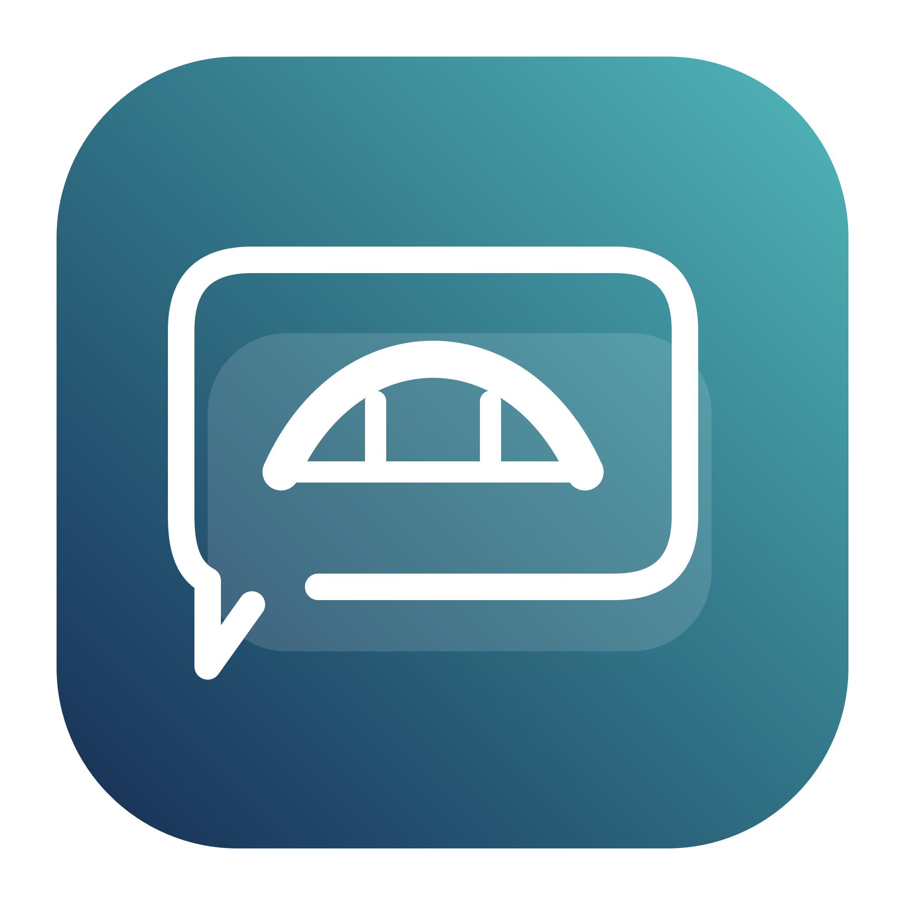

<p align="center"></p>

# 听桥 · CaptionBridge · ことばブリッジ

**听见英语，看见中文。 · Hear English. Read Chinese. · 英語を聴いて、中国語で読む。**

轻量级 macOS 菜单栏 App，将电脑播放的英语会议、课程和视频变为英中双语悬浮字幕。语音识别与翻译在 Mac 本地完成，不上传会议内容、不保存会议录音或字幕。

**要求：Apple Silicon（M 系列） · macOS 27+**。界面与指南支持简体中文、English、日本語；当前字幕方向是 **英语 → 简体中文**。

## 下载与安装 / Download / ダウンロード

**[下载 0.2.0 测试版及三语指南](https://github.com/wangqihanginthesky/CaptionBridge/releases/tag/v0.2.0)**

1. 下载并打开 `CaptionBridge-0.2.0-macOS-arm64.dmg`。
2. 将 `CaptionBridge.app` 拖到 **Applications（应用程序）**，弹出磁盘映像后启动 App。
3. 在 App 中点击 **准备语言模型**，首次联网下载英语识别和英中翻译模型。
4. 在 **系统设置 → 隐私与安全性 → 屏幕与系统音频录制** 中允许 CaptionBridge。按提示确认并重新打开 App。
5. 播放英文会议或视频，点击 **开始字幕**。

安装者不需要 Xcode、Python、Ollama、额外音频驱动或 Apple 开发者会员。

> **测试版签名状态：**当前包为 ad hoc 本地签名，尚无 Developer ID 签名和 Apple 公证。通过互联网下载后可能被其他 Mac 阻止打开。本版本不是公证发行版。请阅读 [Apple 官方说明](https://support.apple.com/102445)，不要关闭系统安全检查。重新构建后可能需要重新授权录制权限。

详见 [三语使用指南](docs/USER_GUIDE.md)、[三语产品介绍](docs/Product-Introduction-zh-en-ja.md)及 [签名与发布说明](docs/RELEASE.md)。完整 HTML 指南也附在 DMG 和 Release 下载文件中，离线可读。

## 功能

- 菜单栏开始 / 停止，英中双语悬浮字幕。
- 可移动、可调整大小的悬浮窗；字幕字号与背景透明度可调。
- 默认 Low Latency 优先速度，可选 High Fidelity 优先翻译质量。
- 简体中文、English、日本語界面与权限指引。
- 模型下载完成后，识别与翻译可离线工作。

仅处理电脑播放的声音，不采集麦克风。当前采集所有 App 的电脑音频；暂不支持按 App 选择、说话人区分或会议存档。中文稍晚于英文，识别中的文本可能修订。短音频已验证，长会议、多屏与休眠恢复仍需验证。

## Privacy

Speech recognition and English–Chinese translation run on-device using Apple frameworks. The app does not upload meeting content, capture the microphone, or save meeting audio/caption files. Only recent captions stay in memory. Initial model downloads and subsequent model updates need internet; meeting apps have their own network behavior. Apple may collect API performance metrics under its own system policies, excluding source/translated content as described in its [TranslationSession documentation](https://developer.apple.com/documentation/translation/translationsession).

## English

CaptionBridge is a lightweight Mac menu bar app with on-device English–Chinese floating captions for meetings, lessons, and videos. Requires Apple Silicon and macOS 27 or later. The interface and guide support Simplified Chinese, English, and Japanese; translation currently targets Simplified Chinese.

Download the DMG from [Releases](https://github.com/wangqihanginthesky/CaptionBridge/releases), drag the app to Applications, prepare language models, then allow **Screen & System Audio Recording** in System Settings. This preview is ad hoc signed and **not notarized by Apple**. See the [English installation guide](docs/USER_GUIDE.md#english).

## 日本語

ことばブリッジ（CaptionBridge）は、Macの再生音から英中二言語のフローティング字幕を表示する軽量メニューバーアプリです。音声認識と翻訳はMac内で処理します。AppleシリコンとmacOS 27以降が必要です。表示とガイドは簡体字中国語・英語・日本語に対応し、字幕方向は現在、英語 → 簡体字中国語です。

[Releases](https://github.com/wangqihanginthesky/CaptionBridge/releases)からDMGをダウンロードし、アプリをアプリケーションへドラッグします。モデルを準備し、システム設定で **画面収録とシステムオーディオ録音** を許可してください。このプレビュー版はアドホック署名で、**Appleの公証は未完了**です。[日本語ガイド](docs/USER_GUIDE.md#日本語)をご覧ください。

## 从源码构建 / Build from source

开发者需要 Apple Silicon、macOS 27+ 和支持 macOS 27 SDK 的 Xcode。

```sh
git clone https://github.com/wangqihanginthesky/CaptionBridge.git
cd CaptionBridge
zsh scripts/build.sh
open .build/CaptionBridge.app
```

生成 DMG：`zsh scripts/package.sh`。本机安装：先退出旧版，再执行 `zsh scripts/install.sh`，然后打开 `~/Applications/CaptionBridge.app`。

## 验证 / Validation

```sh
.build/CaptionBridge.app/Contents/MacOS/LiveCaptions --self-test-report /tmp/captionbridge-self-test.json
# 等 App 中的固定语音示例完成后，在另一个终端运行：
python3 scripts/check-self-test.py /tmp/captionbridge-self-test.json
python3 scripts/check-localization.py
```

固定样本走音频转换 → 语音识别 → 翻译 → 显示流程。系统录制权限和真实电脑音频采集需单独验证。普通使用不写字幕日志；只有显式测试参数会将固定样本的报告写入指定文件。

技术栈：Swift / SwiftUI / NSPanel / ScreenCaptureKit / SpeechAnalyzer + SpeechTranscriber / TranslationSession。

## License

[MIT](LICENSE) · Copyright © 2026 QihangWang.
